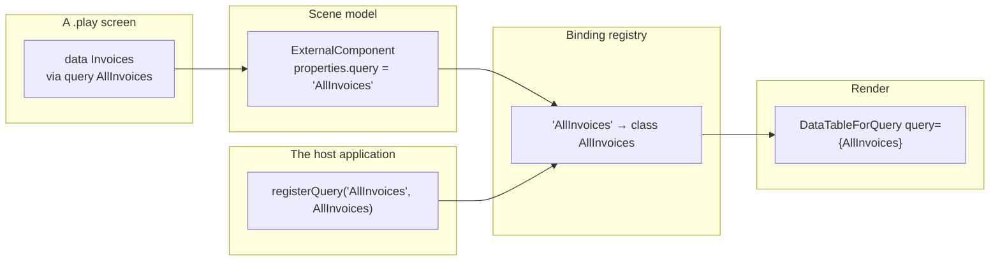

A screen says which data it wants:

```screenplay
data Invoices via query AllInvoices
```

`AllInvoices` is a *name*. By the time that reaches a renderer it is an `ExternalComponent` whose properties
bag holds the string `'AllInvoices'`, because a `.play` document is text, Stage compiles it, and Studio reads
it back — and nothing in that round trip can carry a TypeScript class.

`DataTableForQuery` needs the class:

```tsx
<DataTableForQuery query={AllInvoices} emptyMessage='No invoices' />
```

The host must bridge that gap: it owns the generated class, while Scene carries only its name. Looking up
that name in an explicit registry lets the adapter request the class without guessing module paths or
reaching into application globals.

## The seam



At startup, the host registers the generated Arc proxies its screens can name. The object keys must match
the names in those screens; the values are the actual classes:

```typescript
import { registerQueries, registerCommands } from '@cratis/scene.components';
import { AllInvoices, InvoiceById } from './Invoices/proxies';
import { RegisterInvoice } from './Invoices/RegisterInvoice';

registerQueries({ AllInvoices, InvoiceById });
registerCommands({ RegisterInvoice });
```

This example is an explicit list: object shorthand uses each imported name as the registry key. The bulk
helpers register the entries supplied to them; they do not discover modules or filter their exports.
A host may generate that object, but keeping it aligned with added or removed proxies is the host's
responsibility.

## The API

| Function | Purpose |
|---|---|
| `registerQuery(name, queryClass)` | Register one Arc query proxy under the name screens refer to it by. |
| `registerQueries(bindings)` | Register several at once, keyed by name. |
| `resolveQuery(name)` | The registered class, or `undefined`. |
| `registerCommand(name, commandClass)` | The command half of `registerQuery`. |
| `registerCommands(bindings)` | Register several commands at once. |
| `resolveCommand(name)` | The registered class, or `undefined`. |
| `registeredQueryNames()` | Every registered query name, sorted. |
| `registeredCommandNames()` | Every registered command name, sorted. |
| `clearBindings()` | Forget everything. |

Queries and commands have separate namespaces because each binding site requests a specific kind of work.
Registering a command does not satisfy a screen's query binding, even when the names match.

Registering the same name twice replaces the earlier registration, so a host can re-register on hot reload
without unwinding the previous run. `clearBindings()` exists because the registry is module-level state:
right for a host that registers once at startup, wrong for Studio switching between projects or a spec that
must not inherit what the previous one registered.

## Opt-in exact lookup identities

Use exact identities when source-name collisions must remain visible rather than replace each other.
`queryInputForm` can use `registerQueryIdentity(name, sourceIdentity, proxy)` to distinguish those collisions
from hot-reload replacement. `resolveExactQuery(name)` returns a constructor, `'ambiguous'`, or
`undefined`; `unregisterQueryIdentity(name, sourceIdentity)` removes a source.

This is an opt-in policy, not a change to ordinary registration. `resolveQuery` keeps
legacy last-registration-wins precedence; only when no legacy registration exists does it resolve a
unique identity. Multiple identity-only candidates return `undefined`, producing the existing adapters'
visible unresolved placeholder without selection. Existing adapters look up on host render, not by
subscription. `registeredQueryNames()` includes the sorted union of both namespaces, deduplicated and
including ambiguous names. Registering a lookup in both namespaces makes strict `resolveExactQuery`
ambiguous, while legacy resolution still prefers its legacy registration. Stage can emit one identity
registration per source for the same semantic name and serve both old adapters and `queryInputForm`. See the [query input form contract](query-input-form.md#collision-aware-registration-for-stage)
for the Stage emission pattern, lifecycle and migration boundary.

## The classes are not typed as Arc types

`registerQuery` takes a `BoundConstructor` — "something that can be constructed" — not
`Constructor<IQueryFor<T>>`:

```typescript
export type BoundConstructor = new (...args: never[]) => object;
```

Scene deliberately does not depend on Arc. A Scene screen is a UI model, and the whole point of the registry
is that Scene never has to know what an Arc proxy *is*. Whether a registered class really is a query is the
host's responsibility — and the host checks it where it registers, with the real Arc types in scope, which is
exactly where that check belongs.

## A missing binding is a visible placeholder, never a throw

`resolveQuery` returns `undefined` rather than throwing, and every Arc-bound adapter turns that into a
dashed-out box naming what it wanted:

```text
Unresolved query binding 'AllInvoices' on Cratis.Components:dataTable
```

A screen that names no query at all reads differently, because it is a different mistake:

```text
Missing query binding on Cratis.Components:dataTable
```

For the first message, compare the requested name with the registry's reported query names, then check
registration and spelling in the host. For the second, supply the missing name in the screen. These are
binding problems, distinct from a package that does not declare the component.

This matters most in Studio. Design-time preview normally has *nothing* registered — there is no backend to
query — and the screen still has to be usable so its layout can be worked on. One unbound table costs one
dashed box, not the whole screen. The presentation deliberately matches `UnresolvedComponent` in
`@cratis/scene.react`: the same class of failure at two different depths, and a designer scanning a preview
should recognize both instantly as "something here is not wired up".

## The Arc runtime is loaded only when it is needed

`@cratis/arc` and `@cratis/arc.react` are peer dependencies of `@cratis/components` that the host supplies.
Design-time preview can show the layout before an Arc runtime is available, so every adapter that reaches
them does so through a dynamic `import()`:

```tsx
const DataTableForQuery = lazy(async () => ({ default: (await import('@cratis/components/DataTables')).DataTableForQuery }));
```

A screen made only of the library's Arc-free components — pages, toolbars, editors, tooltips — therefore
never pulls the Arc client in at all, and an unbound table never even reaches the import. When a binding *is*
registered, the chunk loads behind an `ArcRuntimeBoundary`: `Suspense` while it is in flight, and
`@cratis/components`' own `ErrorBoundary` if it cannot load, which is what a host without Arc installed
sees. One dashed-out region, not a blank screen and not a thrown render.

## Where to go next

- [Component reference](components.md) — which components take a binding, and under which property.
- [What this package does not cover](coverage.md) — the other deliberate limits.
