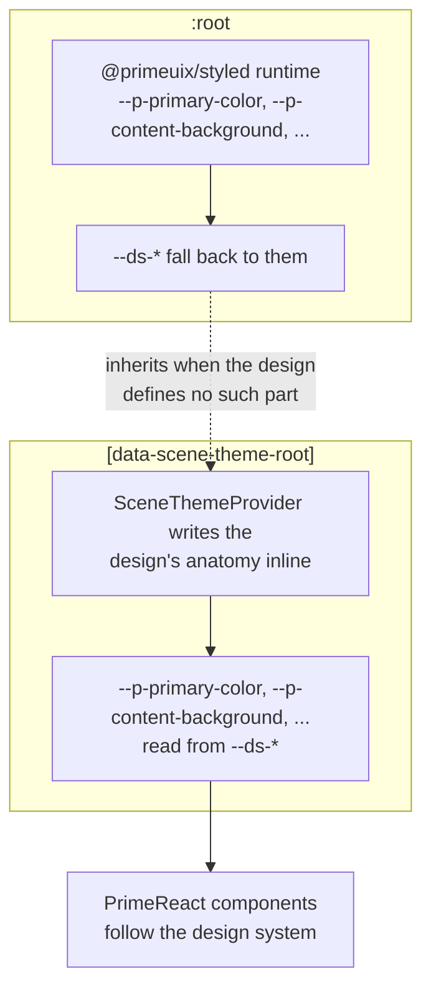

Write one rule that says `color: var(--text-color)` and you have quietly married your layout to PrimeReact.
Swap the component library and every such rule is a search-and-replace. Scene's design-system anatomy is the
seam that prevents this: layout CSS, component CSS and screen styling all read `--ds-<component>-<variant>-<part>`,
and exactly one file in each package knows what that maps to underneath. A package never names a token of a design
system; it reads the anatomy of the components it draws.

## The anatomy

The components PrimeReact draws, and the parts a design system declares for them. See
[Rendering the design system](../blueprints/design-system.md) for the model and the naming rule.

| Anatomy | CSS custom property | What it means |
| --- | --- | --- |
| `Button` `primary` `background` | `--ds-button-primary-background` | The brand accent |
| `Button` `primary` `text` | `--ds-button-primary-text` | Text legible on the accent |
| `Button` `primary` `shadow` in `focus` | `--ds-button-primary-shadow-focus` | The keyboard focus indicator |
| `Shell` `default` `background` | `--ds-shell-default-background` | The page canvas |
| `Shell` `default` `font` | `--ds-shell-default-font` | The font of the whole application |
| `Card` `default` `background` | `--ds-card-default-background` | A raised content surface |
| `Card` `default` `border` | `--ds-card-default-border` | Separation between surfaces |
| `Card` `default` `radius` | `--ds-card-default-radius` | The corner radius of content |
| `Menu` `default` `background` in `hover` | `--ds-menu-default-background-hover` | The hover state of a surface |
| `Menu` `default` `background` / `text` in `selected` | `--ds-menu-default-background-selected`, `--ds-menu-default-text-selected` | Selected rows and options, and the text on them |
| `Popover` `default` `background` | `--ds-popover-default-background` | Dialogs, popovers, drawers |
| `Text` `default` `text` | `--ds-text-default-text` | Body text |
| `Text` `muted` `text` | `--ds-text-muted-text` | Secondary and supporting text |

Anatomy is semantic and platform-neutral in the model on purpose - a design system carries "the `primary` `Button`'s `background`",
not a CSS property name. `designAnatomyProperty` in `@cratis/scene.react` is the one place that decides what it looks like in CSS,
so a future non-DOM renderer can make an entirely different choice:

```ts
import { designAnatomyProperty } from '@cratis/scene.react';

designAnatomyProperty('Button', 'primary', 'background');          // '--ds-button-primary-background'
designAnatomyProperty('Menu', 'default', 'background', 'hover');   // '--ds-menu-default-background-hover'
```

## How the two meet

`primeReactTheme.css` is the only file in this package where a Scene anatomy variable and a PrimeReact variable
name appear together. It bridges them in **both** directions, and the scoping is what makes that safe.



**Downward, on `:root`:** every anatomy variable falls back to whatever PrimeReact theme is loaded. An
application that hands `PrimeReactProvider` a preset and applies no design at all still gets meaningful
values for every anatomy variable above.

```css
:root {
    --ds-button-primary-background: var(--p-primary-color);
    --ds-card-default-background: var(--p-content-background);
    --ds-text-default-text: var(--p-text-color);
}
```

**Upward, inside a themed subtree:** the anatomy is fed back onto PrimeReact's variables, so a design
system re-tints PrimeReact's own components and not only Scene's wrappers.

```css
[data-scene-theme-root] {
    --p-primary-color: var(--ds-button-primary-background);
    --p-content-background: var(--ds-card-default-background);
    --p-text-color: var(--ds-text-default-text);
}
```

> [!WARNING]
> The second rule must never be moved to `:root`. Custom properties that reference each other on the
> **same** element form a cycle, are invalid at computed-value time, and resolve to nothing - both sides
> would silently blank. Split across two elements there is no cycle: `SceneThemeProvider` writes the
> design's anatomy as inline styles on the theme root, which is a literal value with no dependency, and the
> `:root` fallbacks are already resolved by the time they inherit down.

This is the same indirection `@cratis/components/tokens.css` uses to span PrimeReact major versions - one
abstract name resolving to whatever the underlying library calls it this year.

## What this package declares

Every PrimeReact component that takes a look from a design system declares its anatomy in `primeReactAnatomy`: the `button` (the
`primary` variant, with `hover`, `focus` and `active`), the `card`, the `inputText`, the `text` (the `default` and `muted` variants,
chosen by `tone`) and the `overlayPanel`. A design system that asks for a part, variant or state they do not draw - a `secondary`
Button, say - is told so by `linkDesignSystem` rather than approximated.

## Applying a design

`SceneThemeProvider` writes a design's anatomy onto the element it renders, marks that element with
`data-scene-theme-root`, and makes the design available to anything below it:

```tsx
import { SceneThemeProvider } from '@cratis/scene.react';
import { primeReactTheme } from '@cratis/scene.primereact';

<SceneThemeProvider theme={primeReactTheme('lara-dark-indigo')}>
    {children}
</SceneThemeProvider>
```

A `theme` is resolved against the default design system (pass `designSystem` for another one); pass a `design` you have already
resolved with `resolveDesign` to be exact about the mode. Switching rewrites the anatomy on that same element rather than remounting
the subtree, so a preview changes theme without a flash and without losing any state below it.

## Which packages a theme actually reaches

A `Theme` declares `compatibleWith`, and `ThemeCompatibility` reports any package a profile activates that
the theme does not list. There is deliberately **no implicit exemption for `core`** — a theme wanting broad
applicability declares `core` itself, exactly as the package resolver has no special case for it either.

```ts
import { incompatiblePackages } from '@cratis/scene.engine';
import { primeReactTheme } from '@cratis/scene.primereact';

const profile = { name: 'web', targetPlatform: 'web', packages: ['core', 'Tailwind', 'PrimeReact'] };
incompatiblePackages(primeReactTheme('soho-dark')!, profile); // []
```

Every theme in this package lists `['PrimeReact', 'Tailwind', 'core']`, and the `core` entry is a precise
claim rather than a courtesy. A theme reaches a screen in two layers, and only one of them is universal:

- **The preset's `--p-*` properties** are read by PrimeReact's own components. They do nothing for `core`'s bare
  `<span>` and `<button>`.
- **The semantic token layer** applies to everything under the theme root. `core`'s primitives inherit the
  theme's type color, and anything reading the anatomy (`--ds-*`) gets the theme's values.

So the themes genuinely apply to `core` — through anatomy, not through the component skin.

## Next

Anatomy describes the look. Applying a theme is a separate step, because a PrimeReact 11 theme is a preset object
handed to a provider — see
[Switch themes live](./switch-themes-live.md).
